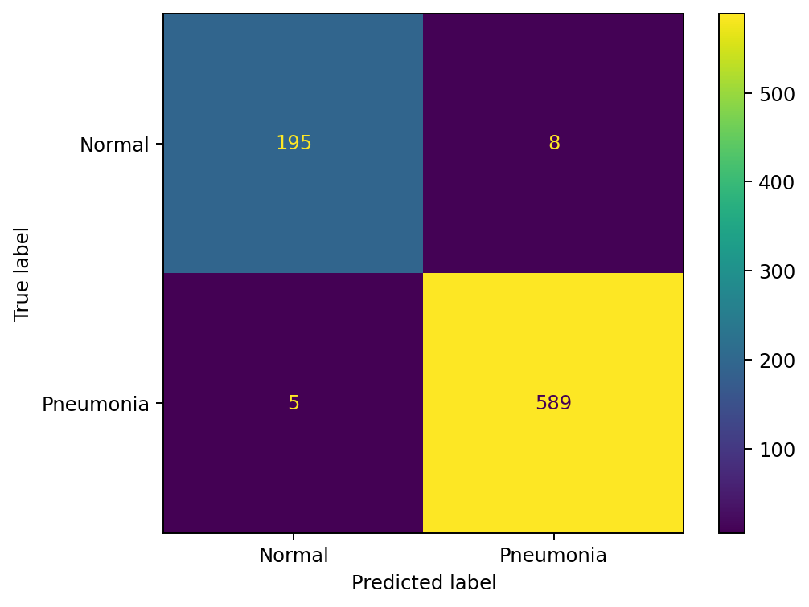
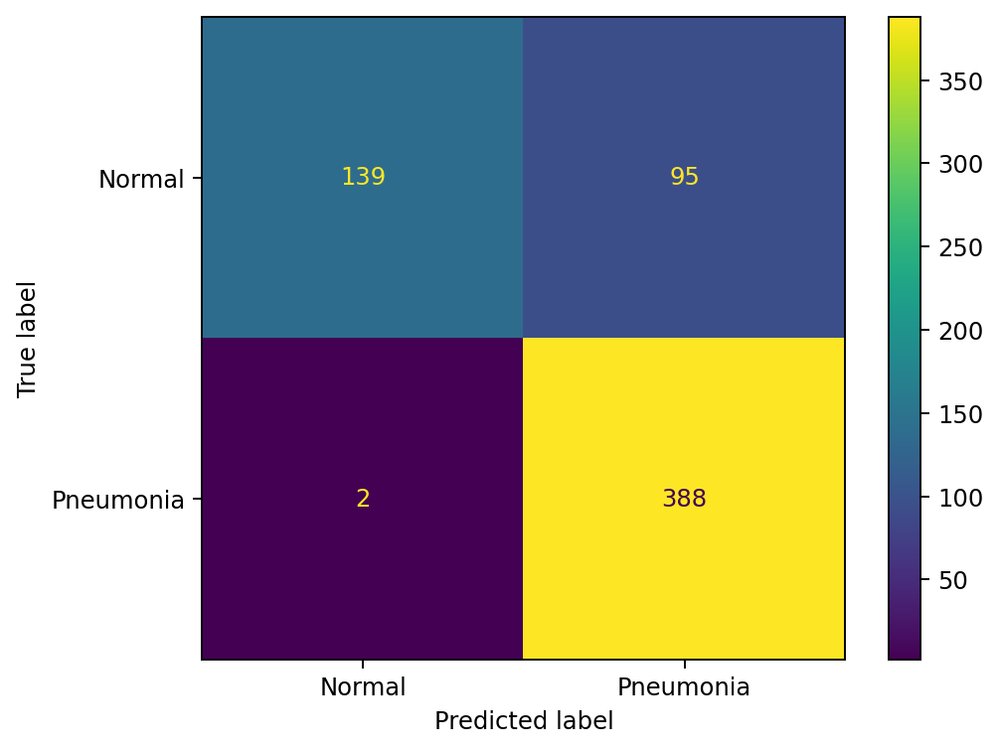
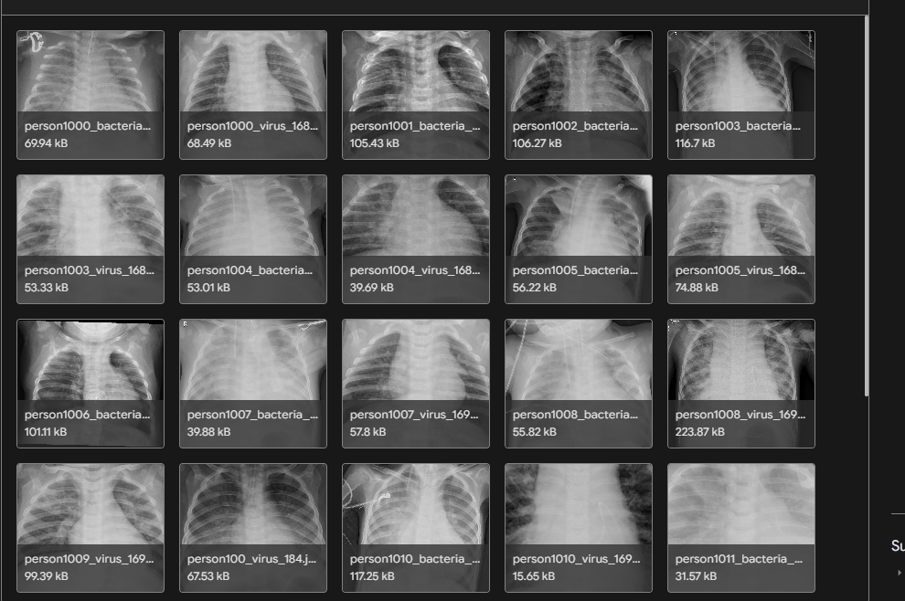
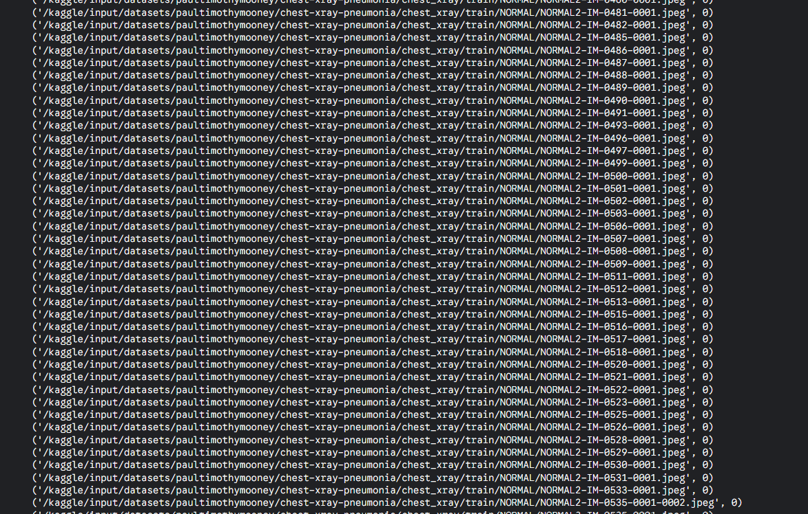

# Chest Xray Classifier
NN resnet model which detects whether or not someone has pneumonia from an Xray of their chest, where I investigated why the model was misclassifying so many normal class x-ray images as pneumonia x-rays, causing low normal recall score.

# Dataset -> Chest X-Ray Images (Pneumonia), link on line below
https://www.kaggle.com/datasets/paultimothymooney/chest-xray-pneumonia
5,863 images

# Final results

 VALIDATION
 ```
              precision    recall  f1-score   support

      Normal       0.97      0.96      0.97       203
   Pneumonia       0.99      0.99      0.99       594

    accuracy                           0.98       797
   macro avg       0.98      0.98      0.98       797
weighted avg       0.98      0.98      0.98       797
```

TESTING
```
             precision    recall  f1-score   support

      Normal       0.99      0.59      0.74       234
   Pneumonia       0.80      0.99      0.89       390

    accuracy                           0.84       624
   macro avg       0.89      0.79      0.82       624
weighted avg       0.87      0.84      0.83       624
```
# Note
Normal recall is around 0.59-0.62 across test runs.

# Key Findings
Model adapts well to unseen images from validation, scoring 96% on the normal class, but drops to around 60% on the test set. Found there to be strong evidence that there is no patient leakage or overfitting, and evidence points to test images differing from training and validation images, as model generalises well to new patients from the exact same source.


# Investigation

```
Results:              precision    recall  f1-score   support

      normal          0.93      0.59      0.73       234
   pneumonia          0.80      0.97      0.88       390

    accuracy                              0.83       624
   macro avg          0.87      0.78      0.80       624
weighted avg          0.85      0.83      0.82       624
```
From these scores, we can see that the normal class has a recall score of 59% whereas the pneumonia class has a score of 97%, indicating to me that the dataset could be imbalanced. To test this, I am going to calculate the imbalance and weights for the 2 classes. Then I will pass these weight values in a tensor where it will be passed into the cross entropy function to penalize the corresponding loss accordingly, rather than treating those two losses the same. Here are the results after including weights:
```
Results:               precision    recall  f1-score   support

          normal       0.94      0.58      0.72       234
       pneumonia       0.80      0.98      0.88       390

        accuracy                           0.83       624
       macro avg       0.87      0.78      0.80       624
    weighted avg       0.85      0.83      0.82       624
 ```
From this, we can observe that these results are actually very similar to the results of the classification report with no weights included, meaning that this did not solve the problem and the data being imbalanced is not the problem.

One thing the recall problem could be is the ResNet hidden layers being frozen. As the ResNet model was trained with millions of random images in various categories, however because of this, the features of different X-ray images may not be picked up effectively in the last layers of the model, especially the output layer.

The fix - I am going to unfreeze the backbone layers to make sure the layers are actually learning the different features from the X-rays. However, before doing this I need to make sure the layers are still frozen whilst intitalising the output head and its parameters, to ensure that it wont pass noise into the backbone and compute wild gradients. For the output layer, I will only run this for 3 epochs as its just a single layer, and 5 epochs for the backbone to prevent overfitting.
```
Results:               precision    recall  f1-score   support

      normal           0.99         0.61      0.75       234
   pneumonia           0.81         0.99      0.89       390

    accuracy                                 0.85       624
   macro avg           0.90        0.80      0.82       624
weighted avg           0.88        0.85      0.84       624
```


From these results, I can see that there is improvement overall, as the precision for normal class and recall for pneumonia is almost perfect. The normal recall still isn't good enough however it is moving in the right direction with a 0.03 increase. Overall, we can see the model is biased towards pneumonia.


Update- the small increase in normal recall was because I didn't set a random seed, recall for the normal class is 60%.
In the context of a medical screening tool, this is the better trade-off compared to the pneumonia recall being 60%, as that would mean that 40% of patients suffering with pneumonia would be told that their chest x-rays are normal, leading to worsening health complications.

Initially I believed one of the issues could've been a class imbalance with the data, however this can not be the case as recall is computed within a single class, different to precision which is calculated across the two classes, so the proportion of images is not the problem.


So I think the problem points to one of two problems: There is overfitting and the model is training the pneumonia x ray images too closely (due to the accuracy being 85% and average loss being low), or there is a difference between the training images vs the test images. These issues are not mutually exclusive.

One fix now I will make is actually splitting the training data between training data and validation data in a 85/15 split.
After that I can then propose an experiment from the results of validation and testing to identify the problem:

If Validation results are poor and test results are poor -> the problem is overfitting.
If Validation is good and test results are poor -> problem is the test images are different to the training and validation


Down below you can see there are repeats of patients 1000,1003,1004,1005,1010. This means that there is most likely a data leakage, as there is probably the same copies across the training and validation splits. This could be the reason recall is high during validation but not so high for testing, as the model can just remember what the last image from the same patient looked like, and conclude it is the same class without actually inspecting the features. So, I need to implement a patient-level split ensuring the same patient's x-rays are on one split and not in both.



Here is another image of some of the imgs attribute of the ImageFolder object total_train_ds, showing the image's file path what class it is in and contains sequences of 4 digit numbers. From inference, the first 4 digits sequence appears to be a different number assigned to each image, a patient ID number if you will. Then the path is typically followed by 0001 for images, where some are then followed by 0002 (still not quite sure what that means), and the unique number is preceded by the letters 'IM'. The main point of analysing this attribute is to inspect this unique number. If we can find two images with the same number, we can make sure that the two images are kept in the same split and not mixed into both. Now, some of the images have the same patient id, but one is marked 'IM' and the other 'NORMAL2'. Although I'm not sure what this discrepancy means, I will still put those images in the same split as that is much better than putting them into different splits.




Now to check if patient leakage is inflating scores, I will implement a patient split instead of a random split. This will be done by taking those unique patient id's from the filenames and using the GroupShuffleSplit function from scikit-learn to organise them into training and validation splits in terms of their indices.  BY doing so, we can now get the corresponding index to the id from the patient_ids variable. Now we have the image and its path from the dataset and its index, to then create different subsets for training and validation and use it for training. 

This time, I expect the normal recall for validation to decrease, as it would mean the model isnt taking shortcuts to classify images.

After running, validation normal recall is still 0.96-0.98, meaning that the patient leakage across splits didnt actually affect scores.

Therefore, I can confidently conclude that there are differences between the training and test images.


# Limitations

Final results are from a single run and will slightly change after running again due to GPU non determinism, even after setting random seed.

#Next Steps
Add GRAD-CAM then cross-dataset generalisation

How to run -> Open pneumoniaV2.ipynb as a kaggle notebook, uploading from github, then attach corresponding dataset and run all cells.


