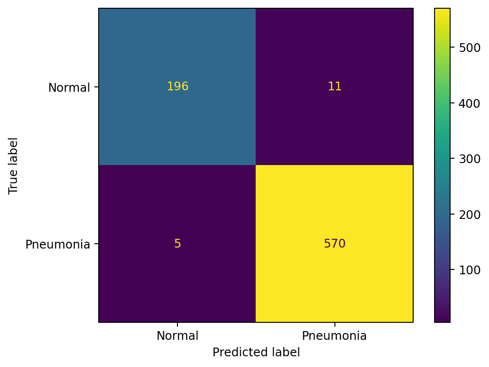
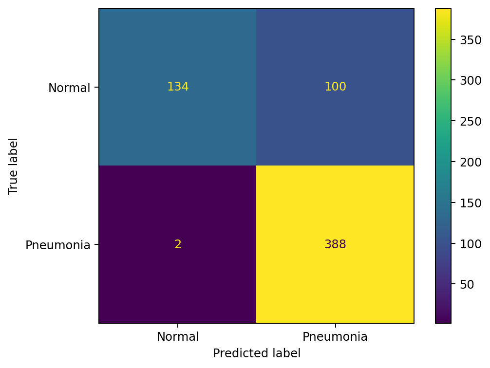

# Chest-Xray-Classifier
NN resnet which detects whether or not someone has pneumonia from an Xray of their chest.

## Status - Work in progress, currentlyfixing.
-Update - now fixing recall problem with the normal class.

Dataset -> Chest X-Ray Images (Pneumonia), link on line below
https://www.kaggle.com/datasets/paultimothymooney/chest-xray-pneumonia
5,863 images

Results:               precision    recall  f1-score   support

                  normal       0.38      1.00      0.55       234
               pneumonia       0.00      0.00      0.00       390

               accuracy                           0.38       624
               macro avg       0.19      0.50      0.27       624
            weighted avg       0.14      0.38      0.20       624

Update - the bug turned about to be a data input issue, where the training data wasn't getting the data it should've been getting due to me inputting the wrong path. Here is the updates results from the classification report:

Results:              precision    recall  f1-score   support

      normal          0.93      0.59      0.73       234
   pneumonia          0.80      0.97      0.88       390

    accuracy                              0.83       624
   macro avg          0.87      0.78      0.80       624
weighted avg          0.85      0.83      0.82       624

From these scores, we can see that the normal class has a recall score of 59% whereas the pneumonia class has a score of 97%, indicating to me that the dataset could be imbalanced. To test this, I am going to calculate the imbalance and weights for the 2 classes. Then I will pass these weight values in a tensor where it will be passed into the cross entropy function to penalize the corresponding loss accordingly, rather than treating those two losses the same. Here are the results after including weights:

Results:               precision    recall  f1-score   support

          normal       0.94      0.58      0.72       234
       pneumonia       0.80      0.98      0.88       390

        accuracy                           0.83       624
       macro avg       0.87      0.78      0.80       624
    weighted avg       0.85      0.83      0.82       62
 
From this, We can observe that these results are actually very similar to the results of the classification report with no weights included, meaning that this did not solve the problem and the data being imbalanced is not the problem.

One thing the recall problem could be is the ResNet hidden layers being frozen. As the ResNet model was trained with millions of random images in various categories, however because of this, the features of different X-ray images may not be picked up effectively in the last layers of the model, especially the output layer.

The fix - I am going to unfreeze the backbone layers to make sure the layers are actually learning the different features from the X-rays. However, before doing this I need to make sure the layers are still frozen whilst intitalizing the output head and its parameters, to ensure that it wont pass noise into the backbone and compute wild gradients. For the output layer, I will only run this for 3 epochs as its just a single layer, and 5 epochs for the backbone to prevent overfitting.

Results:               precision    recall  f1-score   support

      normal           0.99         0.61      0.75       234
   pneumonia           0.81         0.99      0.89       390

    accuracy                                 0.85       624
   macro avg           0.90        0.80      0.82       624
weighted avg           0.88        0.85      0.84       624

From these results, I can see that there is improvement overall, has the precision for normal class and recall for pneumonia is almost perfect. The normal recall still isn't good enough however it is moving in the right direction with a 0.03 increase. Overall, we can see the model is biased towards pneumonia.

The average loss of the model is low, and the test aren't great, which typically indicates overfitting.

Update- the small increase in normal recall was because I didn't set a random seed, recall for the normal class is 60%.
In the context of a medical screening tool, this is the better trade-off compared to the pneumonia recall being 60%, as that would mean that 40% of patients suffering with pneumonia would be told that their chest x-rays are normal, leading to worsening health complications.

Initially I believed one of the issues could've been a class imbalance with the data, however this can not be the case as recall is computed within a single class, different to precision which is calculated across the two classes, so the proportion of images is not the problem.

So I think the problem points to one of two problems: There is overfitting and the model is training the pneumonia x ray images too closely (due to the accuracy being 85% and average loss being low), or there is a difference between the training images vs the test images. These issues are not mutually exclusive.

One fix now I will make is actually splitting the training data between training data validation in a 85/15 split.
Now to see what the problem is out of the two I proposed I will test for validation and test data:

If Validation results are poor and test results are poor, the problem is overfitting.
If Validation is good and test results are poor, problem is the test images are different to the training and validation

To get to the root of the problem now, I will look at some of the images from the original training dataset before splitting.

How to run -> Open pneumoniaV2.ipynb as a kaggle notebook, uploading from github, then attach corresponding dataset and run all cells.

